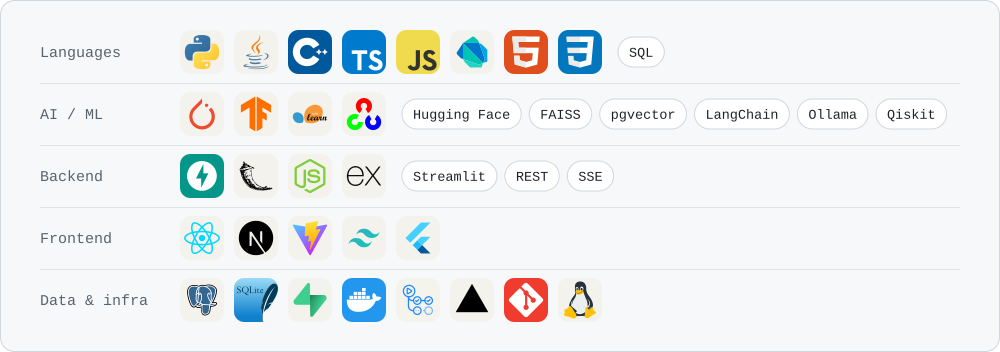

<picture>
  <source media="(prefers-color-scheme: dark)" srcset="assets/header-dark.svg">
  
</picture>

  <a href="https://portfolio-joshith-sai.vercel.app"><picture><source media="(prefers-color-scheme: dark)" srcset="assets/btn-portfolio-dark.svg"></picture></a>
  <a href="https://www.linkedin.com/in/joshith-sai-panchumarthi-646838291/"><picture><source media="(prefers-color-scheme: dark)" srcset="assets/btn-linkedin-dark.svg"></picture></a>
  <a href="https://leetcode.com/u/JoshithSai/"><picture><source media="(prefers-color-scheme: dark)" srcset="assets/btn-leetcode-dark.svg"></picture></a>
  <a href="mailto:joshithsaip@gmail.com"><picture><source media="(prefers-color-scheme: dark)" srcset="assets/btn-email-dark.svg"></picture></a>

## About

I'm a final-year CSE (AI/ML) student at SRM University AP who builds AI products end to end: the retrieval, the model, the API and the interface people actually use. Most of what I make looks something up before it answers, so I care a lot about answers you can check.

- **Now:** building **Vahana** with my UROP team: on-demand and carpool rides for rural communities, with an ML model that ranks which nearby driver is likely to accept (Flutter · FastAPI · PostGIS)
- **Studying:** B.Tech CSE (AI/ML) at SRM University AP, CGPA 9.37/10
- **Before:** AI Research Intern at North Chiang Mai University, predicting Type 2 diabetes from BRFSS health data
- **Certified:** Oracle Certified Professional, Java SE 17 Developer
- **Also:** 3rd place at the AIESEC Hackathon 2025 · led 13 student teams as CEO of GCKC, CESE

## How I build

- **Grounded over fluent.** Answers carry citations a reader can follow, down to the second of a podcast episode in [Lenny Growth Assistant](https://github.com/joshhh62/lenny-growth-assistant).
- **Never trust raw model output.** [Study Assistant](https://github.com/joshhh62/study-assistant) schema-validates every LLM response and retries; [CampusRule AI](https://github.com/joshhh62/campusruleAI) falls back to extractive QA when the local LLM is down; [Qubit-Chat](https://github.com/joshhh62/Qubit-Chat) drops to classical ranking when Grover's search can't help.
- **Runs on a laptop.** Local models through Ollama, one-command Docker Compose and offline mock modes so a demo never depends on an API key.
- **Tested where it matters.** Lenny Growth Assistant has 64 automated tests; CI runs them against a real Postgres + pgvector container with a fake LLM, so builds need no secrets.

## Featured work

<table>
<tr>
<td width="50%" valign="top">

### [Lenny Growth Assistant](https://github.com/joshhh62/lenny-growth-assistant)

Grounded Q&A over 268 episodes of Lenny's Podcast. Every claim cites its episode and deep-links to the exact second on YouTube.

Hybrid retrieval over 27.5k chunks (Postgres full-text + pgvector, fused with RRF) · local Ollama or cloud LLM, switchable mid-chat · sandboxed artifact viewer · 64 tests with CI on every push

`FastAPI` `pgvector` `React` `TypeScript` `Docker`

</td>
<td width="50%" valign="top">

### [Shopify CRO Engine](https://github.com/joshhh62/shopify-cro-engine)

Point it at any Shopify store and get a prioritised conversion audit where every finding cites the storefront data it came from.

ICE-ranked opportunities across 9 areas · 0–100 CRO health score · competitor comparison · A/B experiment briefs · Markdown, HTML and PDF export

`FastAPI` `Next.js` `TypeScript` `BeautifulSoup` · **[Live demo ↗](https://shopify-cro-engine-amber.vercel.app)**

</td>
</tr>
<tr>
<td width="50%" valign="top">

### [Study Assistant](https://github.com/joshhh62/study-assistant)

Turns notes, a topic or a PDF into flashcards and a scored quiz, then tells you which cards to review next.

Zod-validated LLM output with retry · Leitner spaced repetition · refine a set with follow-up instructions · stale-request guards on every call

`React` `Express` `Groq` `Llama 3.3` · **[Live demo ↗](https://study-assistant-five-rose.vercel.app)**

</td>
<td width="50%" valign="top">

### [Skin.AI](https://github.com/joshhh62/Skin_Disease_Analysis)

Classifies six skin conditions from a photo and returns severity, urgency and next steps in five languages, with a downloadable PDF report.

EfficientNetB0 transfer learning with two-phase fine-tuning · **93.25%** validation accuracy, up from 26.37% for a custom CNN baseline

`TensorFlow` `Keras` `Flask` `OpenCV`

</td>
</tr>
<tr>
<td width="50%" valign="top">

### [CampusRule AI](https://github.com/joshhh62/campusruleAI)

Policy assistant over 48 university policy PDFs that streams answers with their sources. 3rd place at the AIESEC Hackathon.

Hybrid FAISS + BM25 retrieval · local LLM via Ollama with RoBERTa extractive-QA fallback · multi-turn memory · analytics dashboard · trie-based autocomplete

`FastAPI` `FAISS` `RoBERTa` `React`

</td>
<td width="50%" valign="top">

### [Qubit-Chat](https://github.com/joshhh62/Qubit-Chat)

Chat with your PDFs, where candidate passages are re-ranked by Grover's search running on Qiskit's Aer simulator.

Oracle + diffuser circuits built per query · classical fallback when quantum can't help · ChromaDB embeddings · Gemini answers · per-user document sessions

`FastAPI` `Qiskit` `ChromaDB` `React` `TypeScript`

</td>
</tr>
</table>

**More:** [FSRCNN Super-Resolution Studio](https://github.com/joshhh62/FSRCNN-Super-Resolution) (2×/4× upscaling with PSNR/SSIM) · [Hotel review sentiment analyzer](https://github.com/joshhh62/hotel_review_sentiment_analyzer) · [Portfolio site](https://github.com/joshhh62/portfolio)

## Tech stack

<picture>
  <source media="(prefers-color-scheme: dark)" srcset="assets/stack-dark.svg">
  
</picture>

  Open to AI/ML and software engineering roles · <a href="mailto:joshithsaip@gmail.com">joshithsaip@gmail.com</a>

